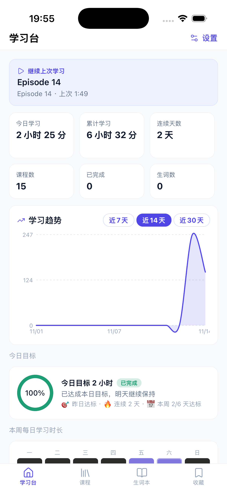
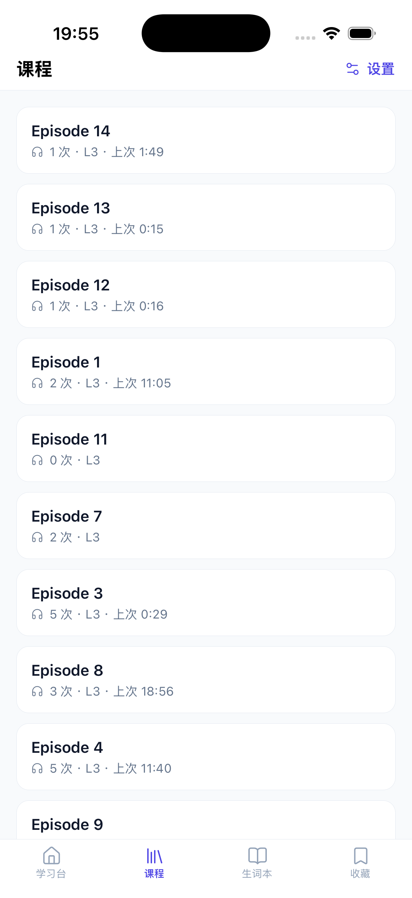
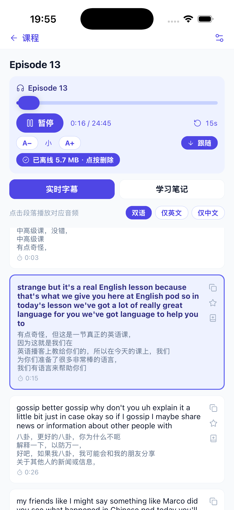
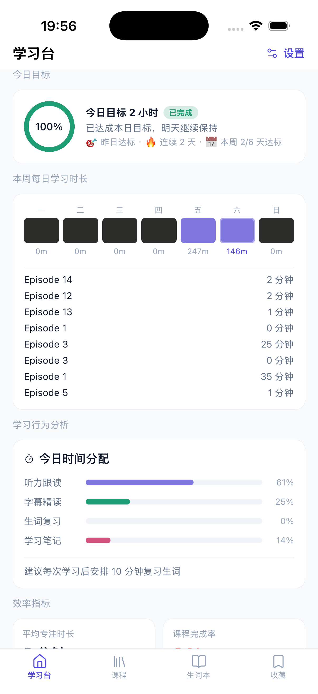

<div align="center">

# EnglishPodcastLearning

**英语播客学习平台 · English Podcast Learning Platform**

*精听 · 双语点读 · 词汇积累 —— 把你的播客资料变成可逐句学习的课程*

[简体中文](README.md) · [English](README.en.md) · [日本語](README.ja.md) · [한국어](README.ko.md)


</div>

---

> 这份 README 按「新人第一次接触项目」的顺序编写：
> **认识项目 → 看懂结构 → 准备环境 → 跑起来 → 导入课程 → 开始学习 → 桌面客户端 → FAQ**。
> 跟着走，30 分钟内可以拥有一个属于自己的播客精听平台。

---

## 1. 这是什么？解决什么问题？

学习英语播客时，你手上通常有一堆散落的资料：**MP3 音频、中英对照 PDF、SRT 字幕**。痛点是：

- 音频和文本对不上，听到不懂的句子要来回拖进度条
- PDF 在 PDF 阅读器里、音频在播放器里、生词记在别处 —— 学习动作被打断
- 没有进度记录，昨天听到第几分钟今天又忘了

**EnglishPodcastLearning 把这些资料自动整理成"可点读的课程"**：

1. 上传同名的 `MP3 + 对照 PDF + 英/中字幕`
2. 系统自动解析 PDF、按集数凑齐文件、用字幕给每段文本配上真实时间戳
3. 人工校对后一键发布为课程
4. 打开课程：**点一下英文段落，音频跳到那句话**，双语对照阅读，生词一键收藏

内含三端客户端：**Web 网站**（浏览器）、**macOS 桌面客户端**（Electron）、**iOS App**（Expo 真机构建），共用同一后端与学习逻辑。

### 核心能力一览

| 模块 | 能力 |
|---|---|
| 🎧 播放器 | 0.5–2x 倍速、±5/30 秒快进退、单篇循环、单句循环、A-B 区间循环、快捷键、进度自动记忆、**Mini Player 页面切换常驻** |
| 📖 双语阅读 | 点段落跳音频、当前段高亮、自动滚动、中英/纯英/纯中切换、复制、收藏、加生词 |
| 📥 智能导入 | PDF 自动解析配对（PyMuPDF）、滚动式 SRT 行级去重、词汇锚点时间戳对齐、跨任务自动聚合、人工校对、纯音频课程 |
| 📊 学习分析 | 今日/累计时长、**播放次数**、连续天数、**学习趋势图（7/14/30 天）**、**今日目标进度环**、**周热力图**、**时间分配（听/读/词/笔记）**、**AI 学习洞察** |
| 📚 词汇 | 生词本状态流转（新/学习中/已掌握）、**词典查询（dictionaryapi.dev 真实释义 + 中译，不虚构）** |
| 🖥 桌面端 | 本地文件导入、托盘播放控制、全局快捷键、音频磁盘缓存秒开、系统媒体元数据（锁屏/蓝牙控制） |
| 📱 iOS | 离线下载（断网可学）、锁屏/灵动岛播放信息、每日目标、**负一屏小组件** |

**一个重要的原则**：段落时间戳只来自真实字幕对齐（约 60% 自动覆盖）或人工标注，**对不上的段落一律留空，绝不伪造**；词典释义只来自真实词典 API 查询，**查不到就显示未收录，绝不虚构**。这是设计底线。

---

## 2. 项目结构导览

先花一分钟看懂目录，后面不再迷路：

```
EnglishPodcastLearning/
├── apps/
│   ├── api/          NestJS 后端 —— 所有业务逻辑、REST API、Swagger 文档
│   │   └── prisma/   数据库模型、迁移、种子数据
│   ├── web/          Next.js 网站 —— 浏览器端界面
│   └── desktop/      Electron 桌面客户端 —— macOS .app
├── packages/
│   ├── types/        共享 TypeScript 类型（三端统一语言）
│   ├── api-client/   统一 API 调用客户端（Web/桌面共用）
│   ├── learning-core/ 纯业务逻辑：SRT 解析、时间戳对齐算法、循环计算
│   ├── player/       音频播放器引擎 + React 组件（两端共用）
│   ├── ui/           共享 UI 组件、主题、中英文案
│   └── config/       共享 tsconfig / Tailwind / ESLint 配置
├── services/
│   └── pdf-parser/   Python PDF 解析器（PyMuPDF，被 API 以子进程调用）
├── data/
│   ├── storage/      上传的音频/PDF 实际存放处（Docker 卷挂载点）
│   ├── imports/      导入暂存
│   └── samples/      样例
├── docs/             详细文档（架构/数据库/导入算法/部署……）
├── docker-compose.yml  一键部署编排（PostgreSQL + API + Web）
├── Dockerfile          多阶段构建
└── turbo.json        任务编排
```

**两句话记住架构**：`Web / 桌面端` 是两个"壳"，共用 `packages/` 里的全部学习逻辑，只跟 `api/` 通信；`api/` 把文件存到磁盘、把数据存到 PostgreSQL，解析 PDF 时调用 Python 脚本。

---

## 3. 环境准备

先确认这几样都装好了（终端里逐条执行检查）：

| 工具 | 版本要求 | 检查命令 | 没装怎么办 |
|---|---|---|---|
| Node.js | ≥ 20 | `node -v` | [nodejs.org](https://nodejs.org) 或 `brew install node` |
| pnpm | ≥ 12 | `pnpm -v` | `corepack enable`（Node 自带）或 `npm i -g pnpm` |
| Docker | 任意近期版 | `docker info` | [Docker Desktop](https://www.docker.com/products/docker-desktop/) |
| Python 3 | ≥ 3.9 | `python3 --version` | macOS 自带 / `brew install python` |
| Git | 任意近期版 | `git --version` | `xcode-select --install` |

> Docker 用于 PostgreSQL（以及可选的一键部署）；Python 用于 PDF 解析。二者缺一都可以先跑通大部分流程，但推荐装齐。

---

## 4. 跑起来（两种方式，选一种）

### 方式 A：Docker 一键部署（最省事，推荐先用这个）

适合：只想尽快用起来，不改代码。

```bash
git clone https://github.com/webEngineerWong/EnglishPodcastLearning.git
cd EnglishPodcastLearning

docker compose up -d --build
```

- 首次构建约 3–5 分钟（拉取依赖 + 编译），之后启动是秒级
- 启动完成后**自动执行数据库迁移**，无需手动建表
- 音频/PDF 存储在宿主机 `./data/storage` 目录（Docker 卷挂载），升级镜像不丢数据

**验证是否成功**：

```bash
docker compose ps        # 三个容器都应是 running / healthy
```

| 服务 | 地址 | 应该看到 |
|---|---|---|
| Web 网站 | http://localhost:3000 | 学习台 Dashboard |
| API | http://localhost:3001/api | JSON 数据 |
| API 文档 (Swagger) | http://localhost:3001/docs | 接口文档 |
| PostgreSQL | localhost:5433 | 账号 `elp` / 密码 `elp_dev_password` |

想加演示课程（一个 24 秒的合成音频 + 双语文本，用来立刻试播放器）：

```bash
docker compose exec api node_modules/.bin/tsx prisma/seed.ts
```

**日常操作**：`docker compose logs -f api`（看日志）· `docker compose down`（停止，数据保留）· `docker compose up -d`（再启动）

### 方式 B：本地开发模式（要改代码时用这个）

适合：想阅读/修改源码，享受热更新。

```bash
git clone https://github.com/webEngineerWong/EnglishPodcastLearning.git
cd EnglishPodcastLearning

# 1. 安装依赖（全 workspace 一次装完）
pnpm install

# 2. 准备 PDF 解析器（创建 Python 虚拟环境并装 PyMuPDF）
pnpm setup:parser

# 3. 启动 PostgreSQL（只数据库用 Docker）
pnpm db:up

# 4. 建表 + 演示数据
pnpm --filter @elp/api prisma migrate deploy
pnpm db:seed

# 5. 启动后端 + 前端（一条命令同时跑，各自热更新）
pnpm dev
```

然后打开 http://localhost:3000 —— 应该能看到学习台 Dashboard，课程列表里有种子数据 **「EP1 - Asking Questions（演示课程）」**，点进去播放器能出声（24 秒合成音调），双语文本可以点击跳转。

> 开发模式下改任何代码都会热更新：`apps/web` 由 Next.js 热更，`apps/api` 由 Nest watch 自动重启，`packages/*` 改动后需要重新 build（`pnpm exec turbo run build --filter @elp/player` 等）。

**分开启动**（想单独看某个服务的日志时）：

```bash
pnpm dev:api        # 只跑后端
pnpm dev:web        # 只跑网站
pnpm dev:desktop    # 跑 Electron 客户端（依赖 API 已启动）
```

---

## 5. 第一次导入你的课程（完整流程）

这是整个项目的核心用法。以一集播客为例。

### 5.1 准备文件

把同一集的资料放进一个文件夹，**文件名以集数编号对应**（这是自动匹配的依据）：

```
Episode 1.mp3                          ← 音频（必需，想听的话）
Episode 1（中英文对照）.pdf             ← 对照文本（必需，想读的话）
Episode 1 （英文字幕）.srt              ← 英文字幕（强烈推荐，提供真实时间戳）
Episode 1（中文字幕）.srt               ← 中文字幕（可选）
```

支持格式：`pdf / txt / srt / mp3 / m4a / wav / mp4`，单文件 ≤ 200MB。
**允许的差异**：全角括号、空格、「英文字幕/中文字幕/对照」等后缀都会被自动忽略 —— 系统只认集数编号（`Episode 1` ≡ `episode1` ≡ `第 1 集`）。
**分多次上传也没关系**：先传 MP3、再传字幕是可以的，系统会自动按集数聚合（见 5.5）。

### 5.2 上传

打开 Web 端 → 左侧 **导入** → 点「选择文件（可多选）」→ 选中上面那组文件 → 上传。

系统后台自动完成：

1. 内容去重（同内容文件只存一份；重复上传直接复用解析结果）
2. PDF 解析：提取段落、识别中英文并配对、过滤页眉/公众号水印、给低把握的段落打置信度标记
3. 字幕解析（包括滚动卡拉OK式字幕的行级去重）
4. 用字幕给 PDF 段落分配真实时间戳（约 60% 自动对齐，其余留空待人工校准）
5. 同名 MP3 自动挂到课程

### 5.3 校对（人工把关）

任务状态变为 **REVIEWING** 后，点进任务进入**校对界面**：

- 上面是文件列表（每个文件的状态、段落数）
- 点任一文本文件 → 下方出现**段落校对列表**：
  - **✎ 编辑**：直接修改英文/中文文本
  - **✂ 拆分**：把一个长段落按句子拆成两段
  - **合并**：勾选相邻的多段 → 一键合并
  - **↑↓**：调整顺序 · **🗑**：删除段落（比如删掉误识别的页眉残留）
  - **低置信度段落有琥珀色标记**（左侧黄条 + 百分比），建议优先校对这些
- 每段右侧可看到分配到的时间戳（⏱ 45s）；没有时间戳的段落显示为空

### 5.4 发布

页面底部填课程标题（可选）、选分类 → 点 **确认 & 发布**：

- 生成正式课程：双语文本 + 音频 + 时间戳 + 学习记录全部就位
- **原始 PDF/MP3 同时存档**，随时可追溯
- 任务状态变 COMPLETED；发布过的内容不会重复发布（同内容防重）

### 5.5 分多次上传怎么办？

很常见：这次只想传音频、下次再传字幕。系统按集数自动聚合：

- 单独传的 MP3 会显示状态 **「待文本」**（已存储，等同名文本）
- 之后任何时候上传同集数的 PDF/SRT → 新任务处理完会**自动把之前的文件拉进来凑成一组**
- 也可以手动点任务列表右上角的 **「🔍 重新匹配」** 立即触发聚合
- 只传音频也能发布 —— 会生成"仅音频课程"，文本以后在课程详情页点 **📎 追加音频/文本** 补传

### 5.6 在课程详情页补传

打开任意课程 → 右上角 **📎 追加音频/文本** → 选择文件 → 立即挂到当前课程（用于补字幕、换音质更好的音频等）。

---

## 6. 开始学习（课程页使用指南）

打开课程后的界面分三块：**顶部播放器、中间双语正文、底部学习笔记**。

### 播放器控件

```
[进度条] 0:45  ⏪ ⏩ ⏮ [▶] ⏭  9:37     Episode 3.mp3     [🔁] [🔂] A-B  1x 🔊 ——
```

| 控件 | 说明 |
|---|---|
| 进度条 | 点击任意位置跳转；A-B 循环时区间显示为琥珀色 |
| ⏪ / ⏩ | 快退 / 快进 5 秒 |
| ⏮ / ⏭ | 上一篇 / 下一篇（多音频课程） |
| ▶ / ⏸ | 播放 / 暂停 |
| 🔁 | 单篇循环（整条音频循环） |
| 🔂 | 单句循环（当前段落来回播放 —— 精听利器） |
| A-B | 区间循环：点 A-B 进入区间模式，再点 A / B 两个小按钮把当前时间设为区间起止 |
| 1x | 倍速：0.5x / 0.75x / 1x / 1.25x / 1.5x / 2x |
| 🔊 | 音量滑杆 + 静音 |

### 键盘快捷键（在课程页内生效）

| 按键 | 功能 |
|---|---|
| `空格` | 播放 / 暂停 |
| `←` / `→` | 快退 / 快进 5 秒（按住 Shift 为 30 秒） |
| `↑` / `↓` | 音量 +10% / -10% |
| `[` / `]` | 倍速 -0.25x / +0.25x |
| `L` | 开关单句循环（当前高亮段落来回播放） |

（输入框聚焦时快捷键自动失效，放心打字。）

### 双语正文

- **点击任意英文段落** → 音频跳到该句开头并自动播放；当前段高亮 + 自动滚动居中
- 顶部 **双语 / 仅英文 / 仅中文** 切换显示模式
- **↕ 自动滚动** 开关：跟读时不希望页面动就关掉
- 段落悬停出现三个操作：**☆ 收藏句子 · 🔤 加入生词本（自动取段落首个长词）· ⧉ 复制中英文**
- 有时间戳的段落右侧显示时间区间；没时间戳的段落点击会提示"未设置时间戳"，可在段落时间编辑器里手动标注
- 右上角 **⏱ 段落时间** 打开时间编辑器：播放到某句开头时点「起点→」、结尾时点「终点→」，人工校准时间戳

**进度是自动的**：播放时每 5 秒静默上报，学习台会显示「继续上次学习」卡片，点一下从上次的位置接着听。

---

## 7. macOS 桌面客户端

### 打包安装

```bash
pnpm install
pnpm --filter @elp/desktop package:dir
```

产物：`apps/desktop/release/mac-arm64/English Podcast Learning.app`（Apple Silicon）。

### 使用

```bash
open "apps/desktop/release/mac-arm64/English Podcast Learning.app"
```

- 功能与 Web 一致（课程、校对、生词本、收藏），另加：
- **本地文件导入**：导入页按钮直接弹 macOS 文件选择框，选中即上传
- **系统托盘**：菜单栏常驻图标，可播放/暂停、快进退（不切窗口也能控制）
- **全局快捷键**：`⌘⌥E` 显示/隐藏窗口 · `⌘⌥P` 播放/暂停（任何 App 前台都生效）
- 桌面端连接 `http://localhost:3001` 的 API —— 保持后端在跑即可（Docker 或 dev 均可）

> 首次打开若被 Gatekeeper 拦截（未签名应用）：右键 → 打开；或执行
> `xattr -cr "apps/desktop/release/mac-arm64/English Podcast Learning.app"`

---

## 7.5 iOS 客户端

### 截图

| 学习台 | 课程列表（真实播放次数） | 课程详情（播放 + 双语点读） |
|---|---|---|
|  |  |  |

| 今日目标 + 本周热力图 | 生词本 | 收藏 |
|---|---|---|
|  |  |  |

### 功能

- **学习台**：继续上次学习、6 项统计、学习趋势曲线（7/14/30 天切换）、今日目标进度环（达标变绿 + 庆祝 Toast）、本周热力图（点方块看当日记录）、时间分配（听力跟读/字幕精读/生词复习/学习笔记）、效率指标、AI 学习洞察
- **课程**：列表显示真实播放次数（LearningSession 会话数）、搜索、收藏、上次位置
- **课程详情**：播放/暂停、倍速、±15 秒、字体调节、字幕跟随开关、双语/纯英/纯中、点段落跳音频、段落收藏/加生词/复制、学习笔记 PDF 打开
- **离线下载**：音频 + 双语文本缓存到沙盒，**断网可学**；「已离线 N MB · 点按删除」管理
- **锁屏/灵动岛**：播放信息进系统 Now Playing（封面/进度/±10s 切课）；负一屏小组件显示当前播放 + 最近课程封面（点封面深链续播、按钮可控制播放）
- **设置**：API 地址下拉预设 + 任意手填；API 地址、每日目标、字号均持久化

### 打包到真机（免费签名）

```bash
cd apps/mobile/scripts
# 先创建 .env.device（已被 .gitignore 忽略，含设备 UDID 与你的部署地址）：
cat > .env.device << 'EOF'
export ELP_DEVICE_UDID=<xcrun devicectl list devices 查看>
export ELP_COREDEVICE_ID=<CoreDeviceID>
export ELP_TUNNEL_URL='https://你的隧道域名'
export ELP_LAN_URL='http://192.168.x.x:3001'
EOF
bash reinstall.sh     # 构建 → 装机 → ipa 到桌面 → 启动
```

> `.env.device` 里的部署地址**只在打包时注入**（源码占位符自动替换、构建后还原），不会进入 git 仓库。App 内也可在「设置」随时下拉切换预设或手填地址。

---

## 8. 命令速查表

| 命令 | 说明 |
|---|---|
| `docker compose up -d --build` | 一键部署（构建 + 启动三服务） |
| `docker compose logs -f api` | 跟踪 API 日志 |
| `docker compose down` | 停止（数据保留） |
| `docker compose down -v` | 停止并清空数据库 |
| `docker compose exec api node_modules/.bin/tsx prisma/seed.ts` | 写入演示课程 |
| `pnpm install` | 安装依赖 |
| `pnpm setup:parser` | 安装 PDF 解析器依赖 |
| `pnpm dev` | 开发模式（API + Web） |
| `pnpm dev:desktop` | Electron 开发模式 |
| `pnpm build` | 全量构建 |
| `pnpm test` / `lint` / `typecheck` | 质量检查 |
| `pnpm db:up` / `db:down` | 启停 PostgreSQL |
| `pnpm db:migrate` / `db:seed` | 迁移 / 种子数据 |
| `pnpm --filter @elp/api prisma studio` | 数据库可视化管理 |
| `pnpm check:ui` | UI 规范守门（emoji/调色板/颜色字面量清零） |
| `bash apps/mobile/scripts/reinstall.sh` | iOS 构建并装机（需 `.env.device`） |

---

## 9. 架构一览

```
浏览器 (Next.js)          macOS 桌面 (Electron + React)
        └──────────┬──────────┘
            共用 packages/*（类型 · API 客户端 · 播放器引擎 · UI · 学习逻辑）
                   │ REST (http://localhost:3001/api)
                   ▼
             NestJS API ──── Prisma ──── PostgreSQL
                   │
      ┌────────────┼──────────────┐
      ▼            ▼              ▼
  磁盘存储     Python PDF 解析器   Cloudflare R2（可选，私有桶 + 签名 URL）
(data/storage)  (PyMuPDF 子进程)
```

- **数据模型 16 张表**：Course / Transcript / Paragraph / AudioAsset / Progress / Session / Vocabulary / Favorite / ImportJob …（详见 [docs/DATABASE.md](docs/DATABASE.md)）
- **时间戳对齐算法**：滚动字幕行级去重 → 英文行为主轴 → 罕见词锚点顺序对齐（详见 [docs/PDF_IMPORT.md](docs/PDF_IMPORT.md)）
- **三端共用**：`packages/` 里的播放器引擎、双语阅读器、API 客户端被 Web 与桌面同时引用，改一处两端生效

---

## 10. 常见问题（FAQ）

**Q1：上传后任务一直停在某个状态？**
看任务文件列表里每个文件的状态徽章：`PARSED/MATCHED` 正常 · `SKIPPED（待文本）`= 该音频没找到同集数的文本，等传文本或点「🔍 重新匹配」· `FAILED` 有红色错误信息，可点「重试」。音频文件不需要"解析"，永远不该有"转圈"等待。

**Q2：为什么有些段落没有时间戳？**
自动对齐只给有把握的段落打时间（约 60%），其余一律留空 —— 系统不会编造时间。校对页或课程页的段落时间编辑器可以手动标注。

**Q3：点段落没反应/提示没有时间戳？**
该段落还没有时间戳。两种解法：① 在课程页打开 ⏱ 段落时间编辑器手动标注；② 为该集补传 SRT 字幕后系统会自动对齐。

**Q4：文件名带中文/括号会乱码吗？**
不会。上传时的文件名编码问题已在内置修复中处理（Latin-1 乱码自动纠正 + Unicode NFC 归一化），历史数据的乱码也会在服务启动时自动修复。

**Q5：重复上传同一个文件会怎样？**
按内容（sha256）去重：磁盘只存一份、解析结果直接复用（秒级完成）。同内容重复导入也可以正常发布，不会产生重复课程。

**Q6：桌面客户端打开是黑屏/空白？**
确认 API 已启动（`docker compose ps` 或 `pnpm dev:api`）—— 客户端检测到 API 不可达会显示错误提示而非假数据。仍异常时删除应用后重开，或查看 `~/Library/Logs/DiagnosticReports/`。

**Q7：首次打开 .app 被 macOS 拦截？**
未签名应用的标准提示。右键 → 打开；或终端执行 `xattr -cr "应用路径"`。

**Q8：端口被占用（3000/3001/5433）？**
`lsof -ti:3001 | xargs kill -9` 释放端口；或在 `docker-compose.yml` / 环境变量中改端口（`API_PORT` / `WEB_PORT` / `POSTGRES_PORT`）。

**Q9：想部署到服务器给多人用？**
`ELP_API_URL=https://你的域名 docker compose up -d --build`。数据模型支持多用户，当前为单用户模式（无需登录）。

**Q10：iOS App 显示「无法连接 API」？**
App 的 API 地址可在「设置」下拉切换预设或手动填写。出门在外用隧道域名，在家同一 Wi-Fi 建议切局域网直连（`http://电脑IP:3001`）——局域网直连不依赖任何第三方隧道服务。iOS 打包地址注入见 7.5 节。

---

## 11. 文档地图（遇到问题去哪查）

| 场景 | 文档 |
|---|---|
| 想理解整体设计、数据流向 | [docs/ARCHITECTURE.md](docs/ARCHITECTURE.md) |
| 想改代码、环境问题排查 | [docs/DEVELOPMENT.md](docs/DEVELOPMENT.md) |
| 想了解数据库 16 张表 | [docs/DATABASE.md](docs/DATABASE.md) |
| 想深入 PDF 解析与时间戳对齐算法 | [docs/PDF_IMPORT.md](docs/PDF_IMPORT.md) |
| 想部署到服务器 / 接入 R2 云存储 | [docs/DEPLOYMENT.md](docs/DEPLOYMENT.md) |
| 想知道项目进展到哪了 | [docs/PROJECT_STATUS.md](docs/PROJECT_STATUS.md) · [docs/NEXT_STEPS.md](docs/NEXT_STEPS.md) |

---

<div align="center">

**祝学习顺利 · Happy listening 🎧**

[简体中文](README.md) · [English](README.en.md) · [日本語](README.ja.md) · [한국어](README.ko.md)

</div>

## 客户端（三端）

| 端 | 技术栈 | 目录 | 定位 |
|---|---|---|---|
| Web | Next.js 15 + React + Tailwind | `apps/web` | **资料整理主战场**：导入/校对/发布/全部学习功能 |
| Desktop | Electron + React（复用 Web 组件栈） | `apps/desktop` | 日常学习 + 本地文件导入 + 托盘/快捷键 |
| iOS | Expo SDK 58 / RN 0.88（Development Build） | `apps/mobile` | **移动学习**：离线下载、锁屏/灵动岛、小组件 |

### 三端功能对照

| 功能 | Web | Desktop | iOS |
|---|---|---|---|
| 学习台统计（今日/累计/连续/播放次数） | ✅ | ✅ | ✅ |
| 学习趋势图（7/14/30 天） | ✅ | ✅ | ✅（原生 SVG 曲线） |
| 今日目标进度环 + 周热力图 | — | — | ✅ |
| 时间分配（听/读/词/笔记）+ AI 学习洞察 | — | — | ✅ |
| 继续上次学习（进度自动记忆） | ✅ | ✅ | ✅ |
| 课程列表（搜索/收藏/播放次数） | ✅ | ✅ | ✅ |
| 播放器（倍速/循环/A-B/快进退） | ✅ | ✅ | ✅ |
| Mini Player（页面切换常驻） | ✅ | ✅ | —（全屏播放页） |
| 双语点读（点段落跳音频/高亮/跟随） | ✅ | ✅ | ✅ |
| 段落收藏 / 加生词 / 复制 | ✅ | ✅ | ✅ |
| 生词本（状态流转 + 搜索） | ✅ | ✅ | ✅（列表） |
| 收藏（课程 + 句子） | ✅ | ✅ | ✅（列表） |
| 词典查询（真实释义 + 中译） | ✅ | ✅ | — |
| 导入（PDF/MP3/SRT 多选） | ✅ | ✅（原生对话框） | —（设计为电脑端职责） |
| 导入校对（编辑/拆分/合并/排序/删除） | ✅ | ✅ | — |
| 学习笔记 PDF | ✅（内嵌预览） | ✅（内嵌 + 系统浏览器） | ✅（系统浏览器打开） |
| 课程封面设置 | ✅ | ✅ | 锁屏/小组件展示 |
| **离线下载（断网学习）** | — | — | ✅ |
| 锁屏 Now Playing / 灵动岛 / 负一屏小组件 | — | 系统媒体元数据 | ✅ |
| 托盘控制 / 全局快捷键 | — | ✅ | 锁屏/耳机按钮 |
| 音频磁盘缓存秒开 | — | ✅ | ✅（离线下载） |
| 深色模式 | ✅（默认深色） | ✅ | ✅（跟随系统） |
| 多语言（中/英） | ✅ | ✅ | 中文 |

共享层：`packages/types`（DTO）、`packages/api-client`（fetch 客户端）、`packages/player`（AudioEngine/循环/时间工具）、`packages/ui`（组件+i18n+主题）、`packages/learning-core`（SRT 解析/对齐/统计纯函数）、`packages/icons`（三端统一 lucide 图标）。

三端通过同一 NestJS API 同步业务数据（课程/段落/时间戳/收藏/生词/进度心跳）。
详细审计与对齐状态见 `docs/UI_AUDIT.md`、`docs/IOS_AUDIT.md`、`docs/PLATFORM_PARITY.md`、`docs/THREE_PLATFORM_ROADMAP.md`。
